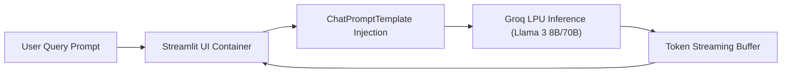

# Groq-Accelerated Conversational QA Engine

[](https://www.python.org/)
[](https://langchain.com/)
[](https://groq.com/)
[](https://streamlit.io/)
[](LICENSE)

---

## Overview

Modern conversational question-answering systems require near-zero latency to maintain conversational flow and user engagement. Traditional cloud API inference often incurs roundtrip times between 2 to 5 seconds, impairing conversational cadence.

This project implements a high-throughput open-domain conversational QA engine utilizing **LangChain** and **Groq Language Processing Unit (LPU)** hardware inference. By offloading inference to Groq's deterministic Tensor Streaming Processor architecture running Llama 3 (8B/70B), the engine achieves token generation speeds exceeding 500 tokens per second while retaining multi-turn conversational context.

---

## Technical Architecture



---

## Key Features

* **High-Throughput Inference:** Integrated with Groq's cloud LPU runtime, delivering near-instantaneous first-token latency and high throughput.
* **Context Retention:** Structured session state preserves conversational context across multiple turns without degrading model attention.
* **Streamlit Interface:** Custom styled client interface with real-time token rendering and parameter controls (temperature, model checkpoint selection).

---

## Setup & Installation

### Prerequisites
* Python 3.10+
* Groq Cloud API Key

### 1. Clone the Repository
```bash
git clone https://github.com/ahmadarif238/Groq-LLM-Q-A.git
cd Groq-LLM-Q-A
```

### 2. Environment Setup
```bash
python -m venv venv

# Windows
venv\Scripts\activate
# Linux/macOS
source venv/bin/activate

pip install -r requirements.txt
```

### 3. Configure API Key
Create a `.env` file in the root directory:
```env
GROQ_API_KEY=your_groq_api_key_here
```

### 4. Run the Engine
```bash
streamlit run app.py
```
Access the application on `http://localhost:8501`.

---

## Author & Academic Context

Engineered by **Arif Ahmad Khan** as an exploration of ultra-low latency language model inference and responsive conversational interface architectures.

Released under the [MIT License](LICENSE).
